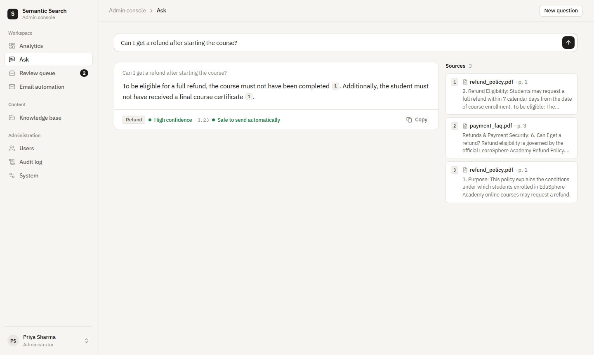
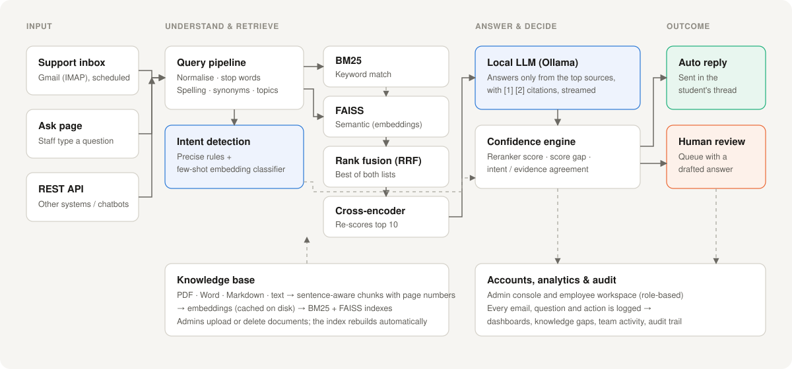
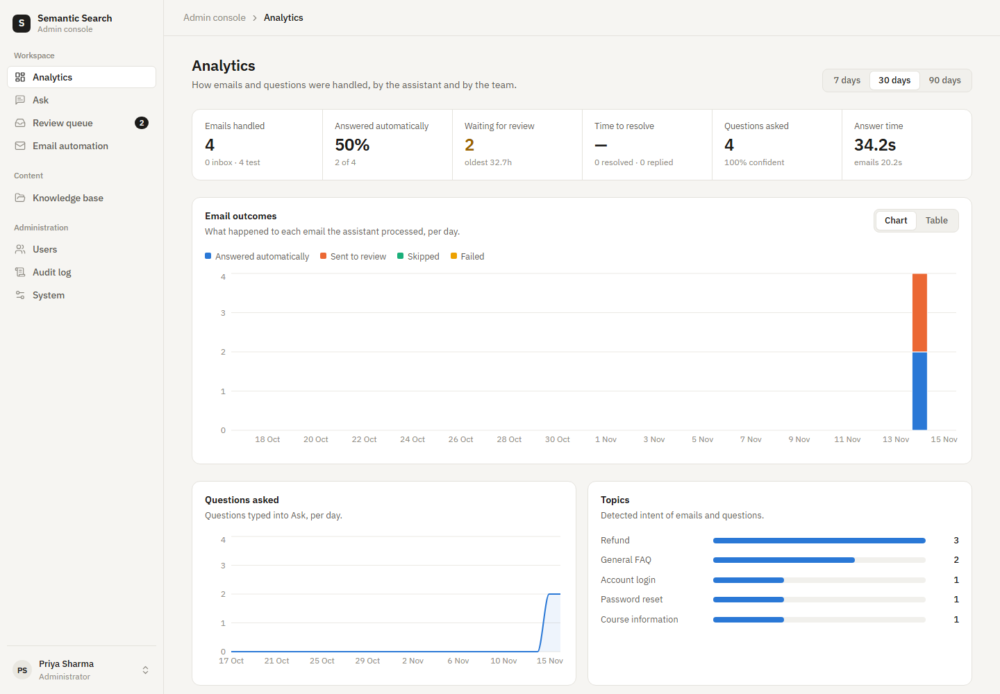
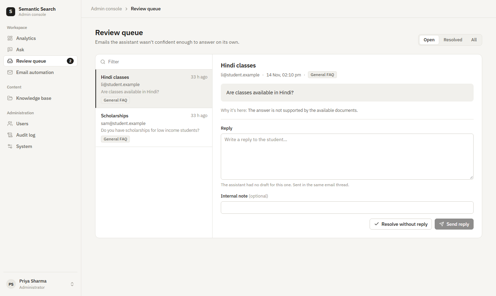
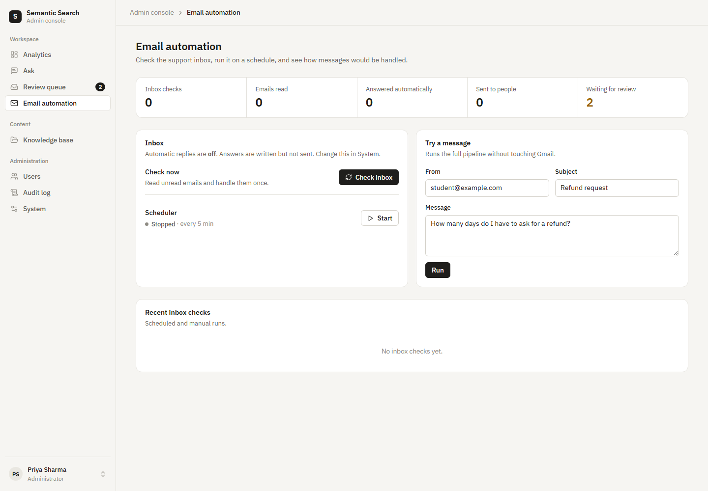
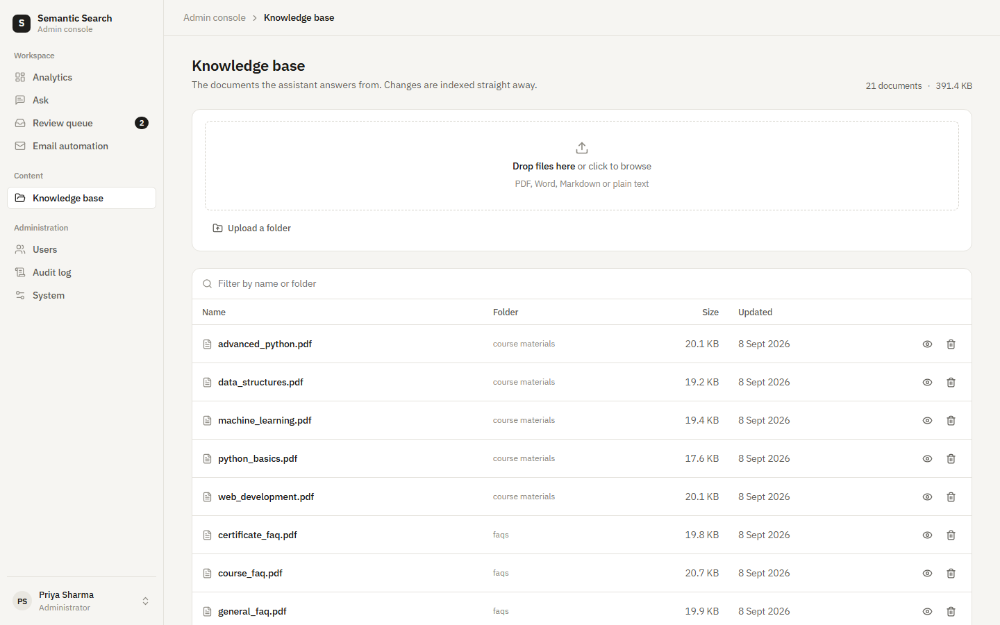
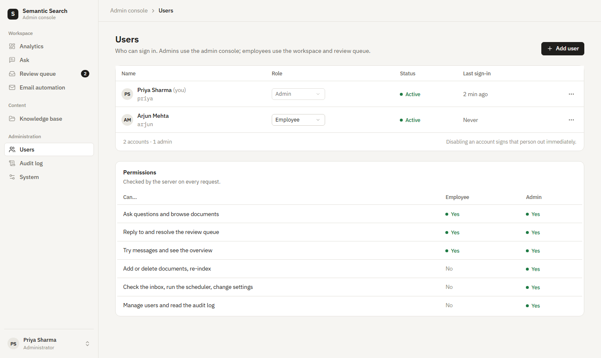
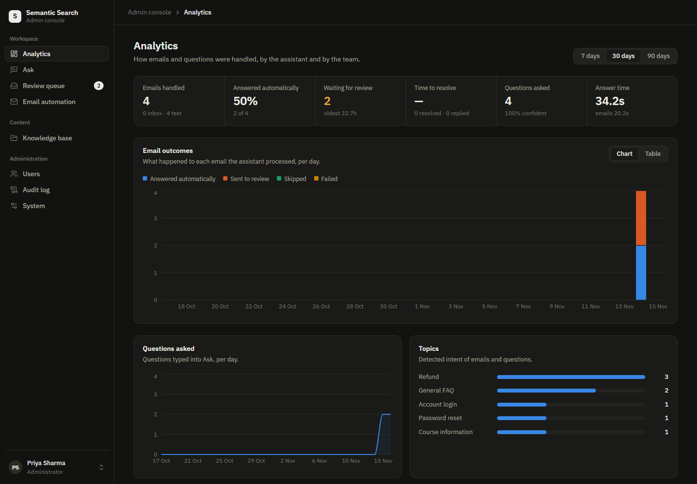
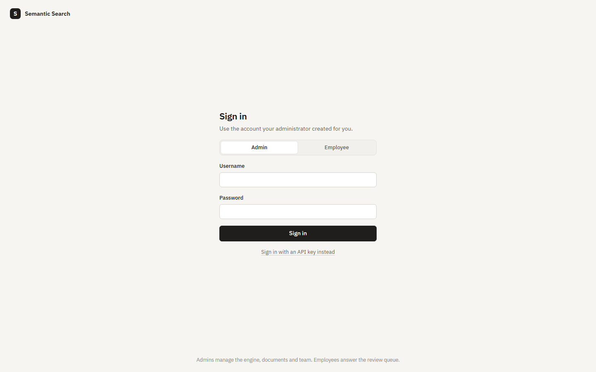
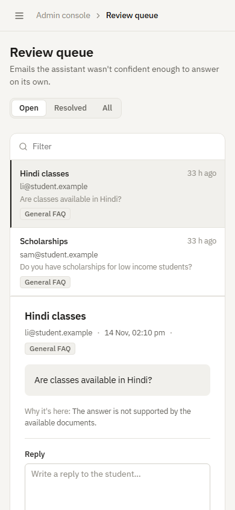

<div align="center">

# Semantic Intent Search Engine

**An AI support agent that reads incoming questions, answers them from your own documents,
and hands only the uncertain ones to a person.**

[](https://github.com/koushikimmidi/Semantic-Search-Engine/actions/workflows/ci.yml)


-1f1e1c)




</div>

---

## Contents

- [Why this project exists](#why-this-project-exists)
- [Where it can be used](#where-it-can-be-used)
- [Features](#features)
- [How it works](#how-it-works)
- [Screenshots](#screenshots)
- [Tech stack](#tech-stack)
- [Installation](#installation)
- [First run](#first-run)
- [Connecting a Gmail inbox](#connecting-a-gmail-inbox)
- [Running with Docker](#running-with-docker)
- [Using it for another domain](#using-it-for-another-domain)
- [Project structure](#project-structure)
- [API reference](#api-reference)
- [Testing and evaluation](#testing-and-evaluation)
- [Configuration reference](#configuration-reference)
- [Troubleshooting](#troubleshooting)
- [Security](#security)
- [Roadmap](#roadmap)

---

## Why this project exists

Call centres, help desks and support inboxes spend most of their time answering the same
questions again and again: *"How do I reset my password?"*, *"What is the refund period?"*,
*"Where is my certificate?"*. The answers already exist — in policy documents, FAQs and
manuals — but a person still has to find them, read them and type a reply.

**The main motive of this project is to eliminate call-centre and other query-based jobs
by automating that work end to end.** The system:

1. **Reads** each question — from an email inbox, the web interface or an API call.
2. **Understands** what is being asked (intent detection) and **finds** the relevant passages
   in the organisation's own documents (hybrid semantic search).
3. **Writes** a short, grounded answer with citations using a local LLM.
4. **Decides** whether that answer is trustworthy enough to send on its own. Confident answers
   go straight back to the customer; anything uncertain is queued for a person with a drafted reply.

Routine queries are answered in seconds, around the clock, at no per-query cost — and because
the language model runs locally, no customer data leaves your machine. People are needed only
for the small share of genuinely new or sensitive cases, and the analytics show exactly which
documents to add so that share keeps shrinking.

## Where it can be used

The engine is domain-agnostic: it answers from whatever documents you give it. This repository
ships with an **education** knowledge base (course policies, FAQs, technical support guides), but
the same code works in any sector that handles repetitive questions:

| Sector | Typical questions it can take over |
| --- | --- |
| 🎓 **Education** | Admissions, fees and refunds, course access, certificates, exam schedules, LMS support |
| 🏥 **Healthcare** | Appointment booking and rescheduling, clinic timings, insurance and billing, pre-visit instructions, lab-report collection *(administrative queries, not diagnosis)* |
| 🏦 **Banking & finance** | Card blocking, account opening documents, KYC, loan eligibility, charges and limits, statement requests |
| 🛒 **E-commerce & retail** | Order status, returns and refunds, delivery, warranty, payment issues |
| 📡 **Telecom & utilities** | Plans and recharges, bill explanations, outages, connection requests |
| 🛡️ **Insurance** | Policy coverage, claim process and documents, renewals |
| 🏛️ **Government & public services** | Application procedures, eligibility, required documents, office hours |
| 🏢 **HR & internal IT help desks** | Leave policy, payroll, onboarding, password resets, VPN and software access |

To switch domains you replace the documents, adjust a few example questions, and re-tune two
thresholds with the included evaluation script — see [Using it for another domain](#using-it-for-another-domain).

## Features

**Answering**
- Hybrid retrieval: **BM25** keyword search + **FAISS** semantic search, merged with Reciprocal Rank Fusion
- **Cross-encoder reranking** of the top candidates for precise relevance
- Grounded answers from a **local LLM** (Gemma via Ollama), streamed word by word, with clickable `[1]` `[2]` citations
- Sentence-aware chunking that keeps section headings and real PDF page numbers
- Persistent embedding cache — only new or changed documents are re-encoded

**Deciding**
- **Intent detection**: precise rules combined with a few-shot embedding classifier (95.6% accuracy on the evaluation set)
- **Confidence engine**: reranker score, score gap and intent/evidence agreement decide *auto-reply* vs *human review*
- Thresholds tuned on a labelled evaluation set — **100% precision** on automatic replies

**Email automation**
- Reads a Gmail inbox over IMAP on a schedule; skips newsletters, no-reply senders and bounces
- Replies in the **same email thread**; de-duplicates by Message-ID; optional mark-as-read
- **Human review queue** with the assistant's drafted answer, ready to edit and send

**Two portals with separate sign-in**
- **Admin console** — analytics, knowledge base, email automation, users, audit log, system settings
- **Employee workspace** — ask questions, work the review queue, test messages
- Hashed passwords, signed expiring sessions, lockout after repeated failures, full audit trail

**Analytics**
- Email outcomes per day, questions asked, topics, answer confidence, review-queue health,
  team activity, and **knowledge gaps** (questions the documents could not answer)

**Engineering**
- FastAPI backend, React + Vite frontend, light and dark themes, responsive layout
- 72 automated tests, GitHub Actions CI, Docker Compose stack (Ollama + API + UI)

## How it works

<p align="center">
  
</p>

1. **Ingest.** Documents (PDF, Word, Markdown, text) are cleaned and split into sentence-aware
   sections. Each section is embedded with `all-MiniLM-L6-v2` and indexed twice: BM25 for exact
   keywords and FAISS for meaning.
2. **Understand the question.** The query is normalised, spell-corrected against the documents'
   own vocabulary, and expanded with domain synonyms (*"pwd"* → *password*, *"charged twice"* →
   *duplicate payment*). Intent is detected in parallel.
3. **Retrieve.** BM25 and FAISS each rank every section; Reciprocal Rank Fusion merges the two
   lists so a passage that is strong on either signal rises to the top.
4. **Rerank.** A cross-encoder (`ms-marco-MiniLM-L-6-v2`) reads the user's *original* question next
   to each of the top 10 passages and scores true relevance.
5. **Answer.** The best passages (up to four) are given to the local LLM, which must answer only
   from them and cite each sentence. If they don't contain the answer, it says so.
6. **Decide.** The confidence engine checks the reranker score, the gap to the next passage, and
   whether the evidence matches the detected intent. Confident → **auto reply** (sent in the
   customer's email thread). Not confident → **human review queue** with the draft attached.
7. **Learn where it falls short.** Every email, question and action is logged. The analytics page
   lists unanswered questions so the team knows which documents to add next.

## Screenshots

<table>
  <tr>
    <td width="50%"><br><sub><b>Analytics</b> — outcomes, topics, confidence, knowledge gaps and team activity</sub></td>
    <td width="50%"><br><sub><b>Review queue</b> — uncertain emails with a drafted reply, sent in-thread</sub></td>
  </tr>
  <tr>
    <td><br><sub><b>Email automation</b> — inbox checks, scheduler and a safe test bench</sub></td>
    <td><br><sub><b>Knowledge base</b> — upload, browse and remove documents; indexing is automatic</sub></td>
  </tr>
  <tr>
    <td><br><sub><b>Users</b> — admin and employee accounts with clear permissions</sub></td>
    <td><br><sub><b>Dark theme</b></sub></td>
  </tr>
  <tr>
    <td><br><sub><b>Sign in</b> — separate admin and employee access</sub></td>
    <td align="center"><br><sub><b>Mobile</b> — responsive layout</sub></td>
  </tr>
</table>

## Tech stack

| Layer | Technology |
| --- | --- |
| Backend API | Python 3.13, FastAPI, Uvicorn, Pydantic |
| Retrieval | rank-bm25, FAISS, Sentence-Transformers (`all-MiniLM-L6-v2`), cross-encoder (`ms-marco-MiniLM-L-6-v2`) |
| Language model | Ollama running Gemma locally (any Ollama model works) |
| Documents | PyMuPDF, python-docx, Markdown, BeautifulSoup |
| Email | IMAP / SMTP (Gmail or any provider) |
| Storage | SQLite (accounts, audit log, analytics), JSON (queue, history), on-disk embedding cache |
| Frontend | React 19, Vite, Recharts, Lucide icons, IBM Plex |
| Quality | pytest, ESLint, GitHub Actions |
| Deployment | Docker, Docker Compose, nginx |

## Installation

### 1. Prerequisites

| Tool | Version | Get it |
| --- | --- | --- |
| Python | 3.13 | <https://www.python.org/downloads/> |
| Node.js | 20 or newer (24 recommended) | <https://nodejs.org/> |
| Ollama | latest | <https://ollama.com/download> |
| Git | any | <https://git-scm.com/downloads> |

Hardware: 8 GB RAM minimum, 16 GB recommended. No GPU required. The default model
(`gemma4`) needs about 10 GB of disk; smaller models such as `gemma3:4b` or `llama3.2:3b` also work.

### 2. Clone the repository

```bash
git clone https://github.com/koushikimmidi/Semantic-Search-Engine.git
cd Semantic-Search-Engine
```

### 3. Download the language model

```bash
ollama pull gemma4
```

Ollama runs in the background after installation. Check it with `ollama list`.

### 4. Set up the backend

**Windows (PowerShell)**

```powershell
python -m venv venv
venv\Scripts\activate
pip install -r requirements.txt --extra-index-url https://download.pytorch.org/whl/cpu
```

**macOS / Linux**

```bash
python3 -m venv venv
source venv/bin/activate
pip install -r requirements.txt --extra-index-url https://download.pytorch.org/whl/cpu
```

> The extra index installs the CPU build of PyTorch, which is much smaller than the default CUDA build.
> Drop it if you want GPU acceleration.

The first start downloads the embedding and reranker models (about 200 MB) from Hugging Face.

### 5. Configure

Copy the template and edit it:

```bash
# Windows
copy .env.example .env
# macOS / Linux
cp .env.example .env
```

At minimum set **`ADMIN_API_KEY`** — it is the setup key for creating the first admin account.
Generate a strong one with:

```bash
python -c "import secrets; print(secrets.token_urlsafe(32))"
```

Email settings are optional; the app works without them (see [Connecting a Gmail inbox](#connecting-a-gmail-inbox)).

### 6. Start the backend

```bash
python -m uvicorn backend.api.app:app --port 8000
```

Wait for `Uvicorn running on http://127.0.0.1:8000`. Interactive API docs: <http://localhost:8000/docs>.

### 7. Start the frontend

In a second terminal:

```bash
cd semantic-search-frontend
npm install
npm run dev
```

Open the address Vite prints (normally <http://localhost:5173>). If that port is taken, run
`npm run dev -- --port 5180` and open <http://localhost:5180>.

## First run

1. Open the web interface. Because no accounts exist yet, it shows **Set up your workspace**.
2. Enter your `ADMIN_API_KEY` as the **setup key**, then your name, a username and a password (8+ characters).
3. You are now in the **Admin console**. Go to **Users → Add user** to create accounts for your team.
   Choose **Employee** for support staff and **Admin** for people who manage the system.
4. Employees sign in on the **Employee** tab and land in the review queue.
5. Try the **Ask** page with a question such as *"How many days do I have to ask for a refund?"*.

## Connecting a Gmail inbox

1. Turn on **2-Step Verification** for the Google account at <https://myaccount.google.com/security>.
2. Create an **App Password** at <https://myaccount.google.com/apppasswords> (name it e.g. *Support assistant*).
3. In `.env`, set `EMAIL_USERNAME` and `SMTP_USERNAME` to the address, and `EMAIL_PASSWORD` and
   `SMTP_PASSWORD` to the 16-character app password (without spaces). Make sure IMAP is enabled in
   Gmail settings → *Forwarding and POP/IMAP*.
4. Restart the backend. In **Email automation**, click **Check inbox** to process unread mail once,
   or **Start** the scheduler to check every few minutes.
5. Automatic replies are **off** by default — answers are written and confident ones are logged,
   uncertain ones go to the review queue, but nothing is emailed. When you are happy with the
   quality, turn on **Send automatic replies** in **System**.

Other providers work too: change `EMAIL_HOST` / `SMTP_HOST` and the ports.

## Running with Docker

Runs Ollama, the API and the web interface together:

```bash
cp .env.example .env        # then set ADMIN_API_KEY (and email settings if needed)
docker compose up --build
```

- Web interface: <http://localhost:8080>
- API: <http://localhost:8000/docs>

The first start downloads the LLM (about 10 GB for `gemma4`; set `OLLAMA_MODEL` to a smaller model
to save space) and the retrieval models. Data, indexes and models are kept in named volumes, so
later starts are fast. The knowledge-base folder is mounted from `data/documents/education`.

## Using it for another domain

1. **Documents.** Put your PDFs, Word files or Markdown in a folder (sub-folders are fine) and point
   `KNOWLEDGE_BASE_PATH` at it — or upload them from **Knowledge base** in the admin console.
2. **Intents.** Edit `data/intent/intent_examples.json`: one list of example questions per intent,
   plus an `OUT_OF_SCOPE` list. Ten or so examples per intent is enough. Rules for very specific
   phrases live in `backend/intent/intent_detector.py`; the evidence keywords used by the safety
   check are in `backend/confidence/confidence_engine.py`.
3. **Vocabulary.** Add your domain's abbreviations and synonyms in `backend/query/expander.py`,
   `synonyms.py` and `domain_vocabulary.py`.
4. **Evaluate and tune.** Write 40–100 real questions into `data/eval/eval_set.json`, marking which
   ones your documents can answer, then run:

   ```bash
   python -m scripts.evaluate_intent
   python -m scripts.evaluate_pipeline          # retrieval scores, fast
   python -m scripts.evaluate_pipeline --full   # with the LLM: auto-reply precision and coverage
   ```

   Set the `CONFIDENCE_*` thresholds in `.env` just above the highest score of an unanswerable question.

## Project structure

```text
Semantic-Search-Engine/
├── backend/
│   ├── api/              FastAPI app (app.py) and authentication / roles (auth.py)
│   ├── accounts/         User store, password hashing, signed session tokens
│   ├── analytics/        Event logging and the analytics overview
│   ├── automation/       Email fetch/send, runner, scheduler, history, review queue
│   ├── chunking/         Sentence-aware text chunker
│   ├── confidence/       Confidence engine (auto-reply vs human review)
│   ├── embeddings/       Encoder, FAISS indexer, semantic search, embedding cache
│   ├── engine/           SearchEngine: orchestrates retrieval end to end
│   ├── hybrid/           Reciprocal Rank Fusion
│   ├── indexing/         Document indexer (pages → chunks with metadata)
│   ├── intent/           Rule-based + embedding intent detection
│   ├── llm/              Ollama client (blocking and streaming)
│   ├── loaders/          PDF, Word, Markdown and text loaders
│   ├── query/            Normalise, stop words, spelling, expansion, synonyms
│   ├── rag/              RAG pipeline: sources → prompt → answer → confidence
│   ├── reranker/         Cross-encoder reranking
│   ├── retrieval/        BM25
│   ├── storage/          SQLite database (accounts, audit, analytics, settings)
│   └── …                 config, logging, profiling, filtering, preprocessing
├── semantic-search-frontend/
│   ├── src/
│   │   ├── pages/        Sign-in, Ask, Analytics, Review queue, Users, Audit log, System
│   │   ├── components/   Sidebar, answer and source views, automation, knowledge base, UI kit
│   │   ├── services/     API client
│   │   └── styles/       Design system (index.css) and page styles
│   ├── nginx.conf        Production web server config (proxies /api to the backend)
│   └── Dockerfile
├── data/
│   ├── documents/        Knowledge base (education/ is used by default)
│   ├── intent/           Example questions per intent (classifier training data)
│   └── eval/             Labelled evaluation questions
├── tests/                pytest suite (unit, API and optional integration tests)
├── scripts/
│   ├── evaluate_intent.py      Intent accuracy report
│   ├── evaluate_pipeline.py    Retrieval scores and end-to-end auto-reply precision
│   └── experiments/            Component experiments from development
├── docs/
│   ├── images/           Screenshots and the architecture diagram
│   ├── architecture.md   Architecture notes
│   └── history/          Early development reports and notes
├── .github/workflows/    CI: backend tests, frontend lint/build, Docker build
├── docker-compose.yml    Ollama + API + web interface
├── Dockerfile            Backend image
├── requirements.txt      Python dependencies (pinned, tested)
├── requirements-dev.txt  + pytest, httpx
├── .env.example          Configuration template
└── CHANGELOG.md
```

Runtime data — accounts database, review queue, run history, embedding cache, logs — is created
under `data/automation/`, `data/index/` and `logs/` and is git-ignored.

## API reference

Full interactive documentation is served at `/docs`. Main endpoints:

| Method | Path | Role | Purpose |
| --- | --- | --- | --- |
| `GET` | `/auth/status` | public | Whether first-time setup is needed |
| `POST` | `/auth/setup` | public (setup key) | Create the first admin account |
| `POST` | `/auth/login` | public | Sign in; returns a session token |
| `GET` | `/auth/me` | any | Current user and role |
| `POST` | `/auth/change-password` | signed in | Change own password |
| `POST` | `/search` | any | Answer a question (answer, sources, intent, confidence, routing) |
| `POST` | `/search/stream` | any | Same, streamed as NDJSON (`sources`, `token`…, `done`) |
| `GET` | `/documents` · `/documents/content` | any | List documents / read extracted text |
| `POST` · `DELETE` | `/documents/upload` · `/documents` | admin | Add or remove documents |
| `POST` | `/automation/process` | employee | Run one message through the pipeline |
| `GET` | `/automation/escalations` | employee | Review queue (`?status=PENDING`) |
| `POST` | `/automation/escalations/{id}/reply` · `/resolve` | employee | Reply in-thread / resolve |
| `GET` | `/analytics/overview?days=30` | employee | Analytics data |
| `POST` | `/automation/run` · `/automation/scheduler/start` · `/stop` | admin | Inbox checks and scheduler |
| `GET` · `POST` · `PATCH` · `DELETE` | `/admin/users` | admin | Manage accounts |
| `GET` | `/admin/audit` · `/admin/system` | admin | Audit log, component health |
| `PATCH` · `POST` | `/admin/settings` · `/admin/reindex` | admin | Runtime settings, re-index |

Authenticate with `Authorization: Bearer <token>` (from `/auth/login`) or `X-API-Key: <key>` for scripts.

Example:

```bash
curl -X POST http://localhost:8000/search \
  -H "Content-Type: application/json" \
  -d '{"query": "How many days do I have to ask for a refund?"}'
```

## Testing and evaluation

```bash
pip install -r requirements-dev.txt
python -m pytest                                    # 72 tests, about a minute, no LLM needed
```

Integration tests with the real retrieval models:

```bash
# Windows
set RUN_INTEGRATION=1 && python -m pytest tests/test_integration.py
# macOS / Linux
RUN_INTEGRATION=1 python -m pytest tests/test_integration.py
```

Frontend:

```bash
cd semantic-search-frontend
npm run lint
npm run build
```

Latest evaluation on `data/eval/eval_set.json` (45 labelled questions, education knowledge base):

| Metric | Result |
| --- | --- |
| Auto-reply precision (auto replies that were correct to send) | **100%** |
| Off-topic / unanswerable questions sent to human review | **11 of 11** |
| Auto-reply coverage (answerable questions handled with no human) | 47% |
| Intent accuracy — hybrid / rules only | **95.6%** / 37.8% |

The system is tuned to be safe first: it never auto-replies to a question it cannot support.
Coverage grows as documents are added for the questions listed under *Knowledge gaps*.

## Configuration reference

All settings live in `.env` (see [`.env.example`](.env.example)). The most important:

| Variable | Default | Purpose |
| --- | --- | --- |
| `ADMIN_API_KEY` | — | Setup key for the first admin account; also an admin API key |
| `AGENT_API_KEY` | — | Optional employee-level API key for integrations |
| `OLLAMA_MODEL` | `gemma4:latest` | Language model used for answers |
| `OLLAMA_HOST` | `http://localhost:11434` | Ollama server |
| `EMAIL_*` | — | Inbox to read (IMAP) |
| `SMTP_*` | — | Account used to send replies |
| `AUTOMATION_SEND_EMAILS` | `false` | Send confident answers automatically |
| `AUTOMATION_INTERVAL_SECONDS` | `300` | Scheduler interval |
| `EMAIL_MARK_AS_READ` | `false` | Mark handled emails as read |
| `KNOWLEDGE_BASE_PATH` | `data/documents/education` | Folder of documents to answer from |
| `CHUNK_SIZE` | `700` | Maximum characters per indexed section |
| `CONFIDENCE_VERY_HIGH_THRESHOLD` | `3.0` | Reranker score that allows an auto reply |
| `CONFIDENCE_HIGH_THRESHOLD` / `CONFIDENCE_MIN_SCORE_GAP` | `0.5` / `0.5` | Lower score allowed when clearly ahead of the next source |
| `CONFIDENCE_MEDIUM_THRESHOLD` | `-3.0` | Below this the evidence is treated as weak |

Auto-replies, mark-as-read and the schedule can also be changed at runtime in **System**.

## Troubleshooting

| Problem | Fix |
| --- | --- |
| Page says *Can't reach the backend* | Start the API (step 6) and keep that terminal open. |
| Sign-in shows *The backend did not recognise this request* | An older server is running on port 8000. Stop it, start the current backend. |
| `localhost:5173` opens a different app | Another project uses that port. Run `npm run dev -- --port 5180`. |
| Answers say *I cannot answer this…* for everything | Ollama is not running or the model isn't pulled: run `ollama list` / `ollama pull gemma4`. Check **System → Language model**. |
| First start is slow | Retrieval models download once (~200 MB); later starts load from cache. |
| `pip install` downloads ~2 GB | Use the CPU index: `--extra-index-url https://download.pytorch.org/whl/cpu`. |
| Gmail login fails | Use an App Password (not your account password) and enable IMAP in Gmail settings. |
| Forgot the admin password | Another admin can reset it in **Users**. With no other admin, stop the backend and delete `data/automation/app.db` to run setup again (this removes all accounts). |

## Security

- Passwords are hashed with PBKDF2-SHA256; sessions are signed tokens that expire after 12 hours.
- Five wrong passwords lock an account for five minutes; disabling a user signs them out immediately.
- Every permission is enforced by the server; the audit log records sign-ins and all changes.
- Document paths are confined to the knowledge-base folder; uploads are limited to supported types.
- The LLM runs locally through Ollama — questions and documents are not sent to third parties.
- Keep `.env` private. For internet-facing deployments put the app behind HTTPS (e.g. nginx or Caddy).

## Roadmap

- Better retrieval models (e.g. `bge-small` embeddings, `bge-reranker`) and query rewriting
- Larger real-world evaluation set and continuous evaluation in CI
- Learn from agent replies: approved answers become retrievable knowledge
- Answer-faithfulness check before auto-sending
- Multi-turn conversations and multilingual support
- More channels: website chat widget, WhatsApp, Telegram, Slack

---

<div align="center">
<sub>Built with FastAPI, React and a local LLM. Contributions and issues are welcome.</sub>
</div>
