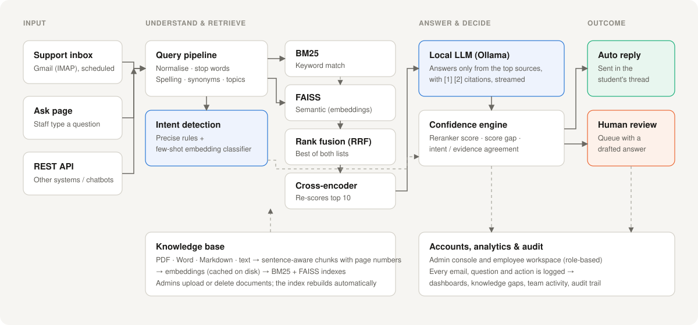

# Architecture

## Request path

| Step | Module | What happens |
| --- | --- | --- |
| 1 | `backend/api/app.py` | Request arrives (`/search`, `/search/stream`, or an email from the runner) |
| 2 | `backend/query/` | Normalise, remove stop words, spell-correct against the corpus vocabulary, expand abbreviations, synonyms and domain terms |
| 3 | `backend/retrieval/bm25.py` | Keyword ranking of every section |
| 4 | `backend/embeddings/` | Semantic ranking with FAISS (cosine) over cached embeddings |
| 5 | `backend/hybrid/` | Reciprocal Rank Fusion of the two rankings |
| 6 | `backend/reranker/` | Cross-encoder rescoring of the top 10 using the original question |
| 7 | `backend/intent/` | Rules + few-shot embedding classifier |
| 8 | `backend/rag/` | Up to four sources become a numbered prompt; the LLM answers with citations |
| 9 | `backend/confidence/` | Score, score gap and intent/evidence agreement → `AUTO_REPLY` or `HUMAN_REVIEW` |
| 10 | `backend/automation/` | Auto-reply in the email thread, or queue for review with the draft |
| 11 | `backend/analytics/` | Event and audit logging for the dashboards |

## Indexing path

`backend/indexing/document_indexer.py` walks the knowledge-base folder, loads each file page by page
(`backend/loaders/`), and splits it with `backend/chunking/text_chunker.py` into sentence-aware
sections prefixed with their heading. `SearchEngine.load()` builds BM25 and FAISS from these
sections; embeddings come from `ChunkEmbeddingCache`, so only new or changed sections are encoded.
Uploads and deletions trigger a reload; searches wait on a lock while the index swaps.

## Access control

`backend/api/auth.py` resolves each request to a principal from a signed session token
(`Authorization: Bearer`) or an API key (`X-API-Key`). Roles: `admin` > `employee`/`agent` > `viewer`.
Accounts, the audit log, analytics events and runtime settings live in SQLite (`backend/storage/`).

## Frontend

React + Vite single-page app (`semantic-search-frontend/`). It calls the API under `/api`, which
Vite proxies in development and nginx proxies in Docker. The current page is kept in the URL hash.
